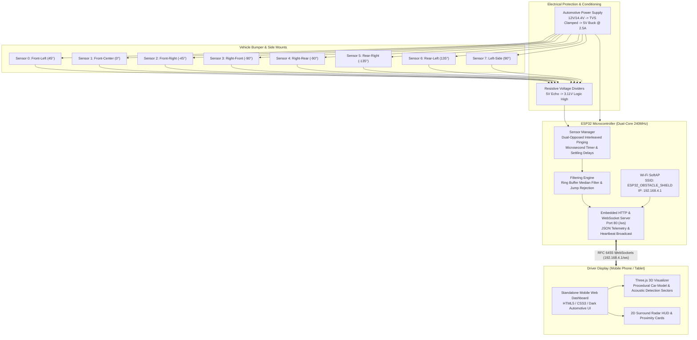

# 360-Degree Vehicle Obstacle Detection Shield

A complete, low-cost prototype measuring obstacle proximity around a passenger vehicle and displaying real-time 3D positions on an interactive mobile web browser dashboard running Three.js over local ESP32 Wi-Fi.

---

## 1. System Architecture



---

## 2. Definitive ESP32-WROOM-32 GPIO Pin Assignment

| Sensor Channel | Vehicle Location | Azimuth ($\theta$) | Trigger Pin (Output, 3.3V) | Echo Pin (Input, via 5V→3.3V Divider) | Silicon Characteristics |
|---|---|---|---|---|---|
| **Sensor 0** | Front-Left (Corner) | $+45^\circ$ | **GPIO 4** | **GPIO 34** | Input-only (ADC1_CH6) |
| **Sensor 1** | Front-Center (Grille)| $0^\circ$ | **GPIO 16** | **GPIO 35** | Input-only (ADC1_CH7) |
| **Sensor 2** | Front-Right (Corner)| $-45^\circ$ | **GPIO 17** | **GPIO 36 (VP)** | Input-only (ADC1_CH0) |
| **Sensor 3** | Right-Front Side | $-90^\circ$ | **GPIO 18** | **GPIO 39 (VN)** | Input-only (ADC1_CH3) |
| **Sensor 4** | Right-Rear Side | $-90^\circ$ | **GPIO 19** | **GPIO 32** | General GPIO / ADC1_CH4 |
| **Sensor 5** | Rear-Right (Corner) | $-135^\circ$ | **GPIO 21** | **GPIO 33** | General GPIO / ADC1_CH5 |
| **Sensor 6** | Rear-Left (Corner) | $+135^\circ$ | **GPIO 22** | **GPIO 25** | General GPIO / DAC1 |
| **Sensor 7** | Left-Side (Mid) | $+90^\circ$ | **GPIO 23** | **GPIO 26** | General GPIO / DAC2 |

*Design Safety Highlights:*
- **Zero Strapping Pin Conflicts:** GPIO 0, 2, 12, and 15 are completely avoided, guaranteeing 100% reliable cold boots and flashing.
- **Flash Protection:** GPIO 6–11 are strictly untouched.
- **Programming Console Preserved:** UART0 (GPIO 1 TX, GPIO 3 RX) remains dedicated for flashing and diagnostic logging.
- **Input-Only Pins Utilized:** The 4 dedicated input-only pins (34, 35, 36, 39) receive Echo signals through dividers.

---

## 3. Voltage Level Shifting & Electrical Protection

### 3.1 5V to 3.3V Echo Voltage Divider
Each JSN-SR04T outputs a $5.0\text{V}$ logic HIGH pulse on Echo. An ESP32 input pin has a maximum rating of $3.6\text{V}$. Pass each Echo wire through a passive resistor divider before connecting to the ESP32:

```
JSN-SR04T (5V)                             ESP32 (3.3V)
Echo Output Pin ────────[ R1: 2.0 kΩ ]──┬──> GPIO Input Pin (e.g. GPIO 34)
                                        │
                                   [ R2: 3.3 kΩ ]
                                        │
GND ────────────────────────────────────┴──> System GND
```

$$V_{\text{ESP32}} = 5.0\text{V} \times \frac{3.3\text{k}\Omega}{2.0\text{k}\Omega + 3.3\text{k}\Omega} = 3.11\text{V} \quad (\text{Safe logic high})$$

### 3.2 Automotive Power Conditioning
Vehicle electrical power fluctuates between $12.0\text{V}$ and $14.7\text{V}$, with cranking dips down to $6\text{V}$ and high-energy inductive load dumps exceeding $+80\text{V}$ (ISO 7637-2).
- **Fuse:** 2.0A fast-blow inline fuse on +12V switched ignition tap.
- **Transient Protection:** SMBJ24CA bidirectional TVS diode across 12V and ground.
- **Reverse Polarity:** SS34 Schottky diode or P-channel MOSFET.
- **Step-Down Regulator:** Automotive buck converter (TI TPS54302 or LM2596-HV) delivering regulated $5.0\text{V} \pm 0.1\text{V}$ @ 2.5A continuous to power the ESP32 VIN and all 8 sensor transceiver boards.

---

## 4. Acoustic Physics, Timing & Update Rate Analysis

### 4.1 Speed of Sound vs. Temperature
Distance calculation uses the round-trip acoustic formula:
$$d = \frac{v(T) \cdot \Delta t}{2}$$
$$v(T) \approx 331.3 + 0.606 \cdot T_{^\circ\text{C}} \quad [\text{m/s}]$$
$$\text{Microseconds per cm} = \frac{20000}{331.3 + 0.606 \cdot T_{^\circ\text{C}}}$$

At standard reference ($20^\circ\text{C}$):
$$v = 343.42\text{ m/s} \implies 58.237\ \mu s/\text{cm}$$

### 4.2 Array Refresh Rate Calculation
- Maximum detection range: $350\text{ cm} \implies 20.4\text{ ms}$ flight time.
- Echo timeout: $25.0\text{ ms}$.
- Acoustic settling interval: $15.0\text{ ms}$ (prevents multi-path echoes from lingering and triggering false readings on adjacent sensors).
- **Dual-Opposed Interleaved Scheduling:**
  Sensors separated by $>4\text{ meters}$ and pointing $180^\circ$ apart (e.g. Front-Left and Rear-Right) are triggered simultaneously in 4 phases:
  - Phase 1: Sensor 0 (FL) & Sensor 5 (RR)
  - Phase 2: Sensor 2 (FR) & Sensor 6 (RL)
  - Phase 3: Sensor 1 (FC) & Sensor 4 (RRS)
  - Phase 4: Sensor 3 (RFS) & Sensor 7 (LS)
  $$\text{Array Sweep Duration} = 4 \times (25\text{ ms} + 15\text{ ms}) = 160\text{ ms} \implies f_{\text{array}} \approx 6.25\text{ Hz}$$
- **UI Rendering Rate:** The Three.js client interpolates smoothly at **60 FPS** while accurately reflecting the physical $6.25\text{ Hz}$ acoustic measurement cycle.

### 4.3 Transducer Blind Zone (Ring-Down Deadband)
The single waterproof piezo transducer requires $\approx 1.3\text{ ms}$ to dampen mechanical vibration after pulsing. Any obstacle closer than $\approx 22\text{ cm}$ falls within this blind zone. The firmware explicitly classifies readings $<22\text{ cm}$ as `"below_blindzone"` and triggers a visual collision alert, **never reporting clear space**.

---

## 5. Firmware Build and Flashing (ESP-IDF v6.0.1)

The firmware is located in `firmware/` and compiles with ESP-IDF:

```powershell
# Set ESP-IDF environment variables
$env:ESP_IDF_VERSION = "6.0.1"
$env:IDF_PYTHON_ENV_PATH = "C:\Espressif\tools\python\v6.0.1\venv"
$env:IDF_PATH = "C:\esp\v6.0.1\esp-idf"
$env:IDF_TOOLS_PATH = "C:\Espressif\tools"
$env:ESP_ROM_ELF_DIR = "C:\Espressif\tools\esp-rom-elfs\20241011"

# Build firmware binary
cd firmware
idf.py build

# Flash to ESP32 board and open serial monitor
idf.py -p COM3 flash monitor
```

---

## 6. Running the Web Application & Simulation

### Option A: Direct ESP32 Connection (In-Car / Bench)
1. Power up the ESP32.
2. Connect your mobile phone or laptop to the Wi-Fi network:
   - **SSID:** `ESP32_OBSTACLE_SHIELD`
   - **Password:** `obstacle1234`
3. Open your browser and navigate to: `http://192.168.4.1/`

### Option B: Zero-Dependency Python Simulator (Bench Test without Hardware)
Run the bundled mock server script:
```bash
python tests/mock_esp32_server.py
```
Open your browser at `http://127.0.0.1:8080/`. The dashboard will automatically connect to the simulated WebSocket stream, displaying realistic dynamic obstacles moving around the vehicle.

---

## 7. Running the Automated Test Suite

A comprehensive test suite verifies acoustic conversion, coordinate geometry, glitch filtering, and JSON protocol compliance:

```powershell
python -m unittest discover -s tests -v
```

**Results:**
- `test_acoustic_math.py`: Speed of sound vs. temperature, microsecond roundtrip, blind zone rejection, timeout handling.
- `test_coordinate_transforms.py`: ISO 8855 horizontal obstacle projection ($x_o, y_o$) and Three.js 3D world mapping.
- `test_filtering.py`: Median filter impulse noise rejection, consecutive timeout reset, proximity threshold classification.
- `test_protocol_schema.py`: JSON telemetry validation, heartbeat verification, and malformed packet rejection.

---

## 8. Safety & Regulatory Disclaimers

> [!WARNING]
> This prototype is an **experimental driver assistance and visualization aid**. It is **NOT** a certified automotive safety device.
> - **Never** connect this system to steering, throttle, braking, or electronic control units (ECU/CAN-bus).
> - Ultrasonic waves reflect specularly from angled surfaces, cylindrical poles, and wire fences, and are absorbed by soft fabrics or vegetation.
> - Always perform manual head-checks and use vehicle mirrors during parking maneuvers.
